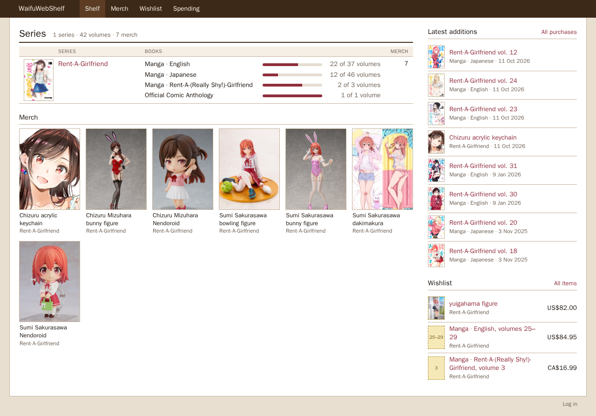
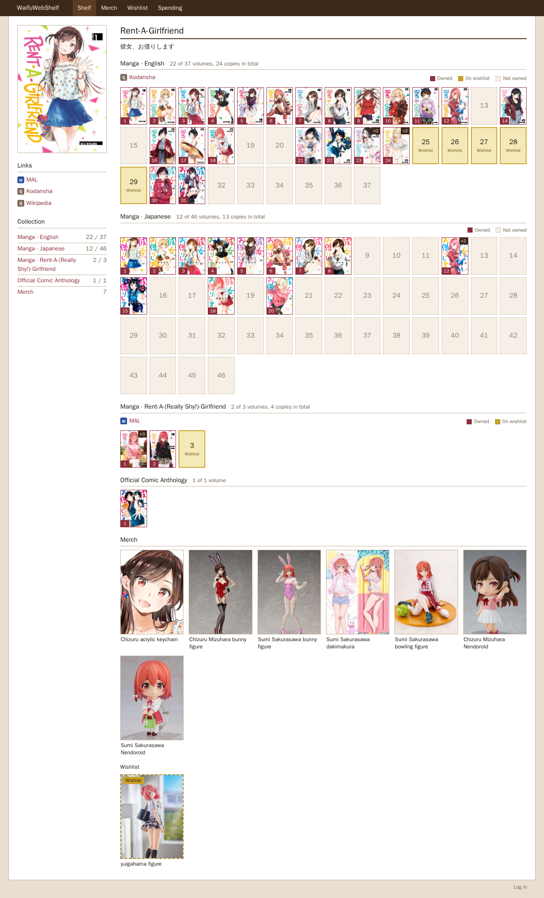
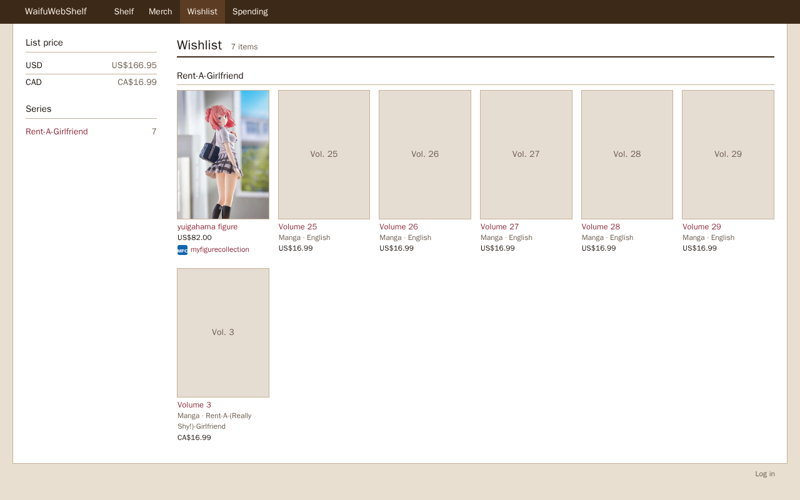
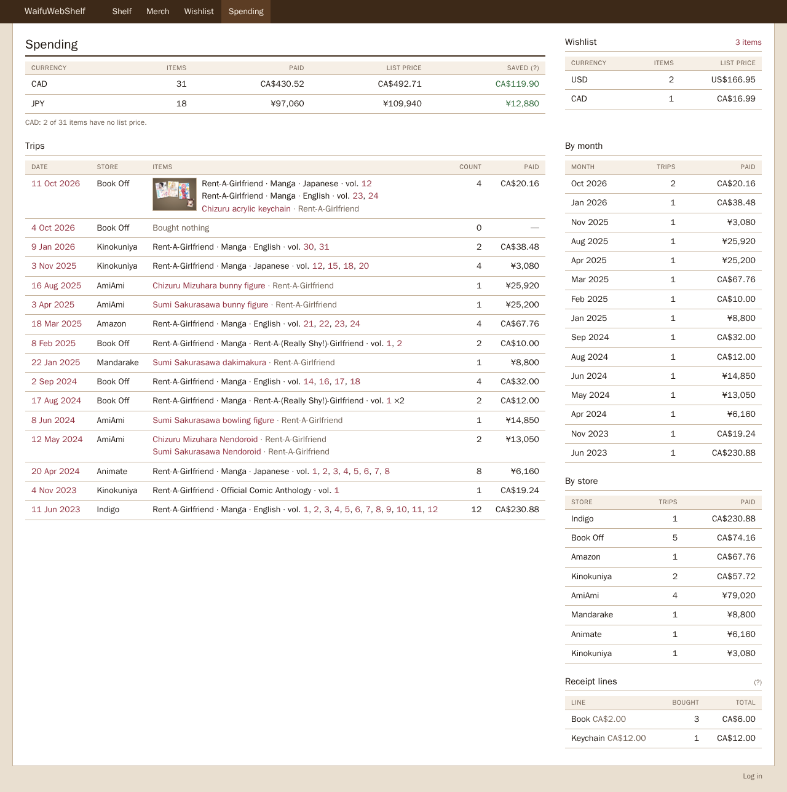
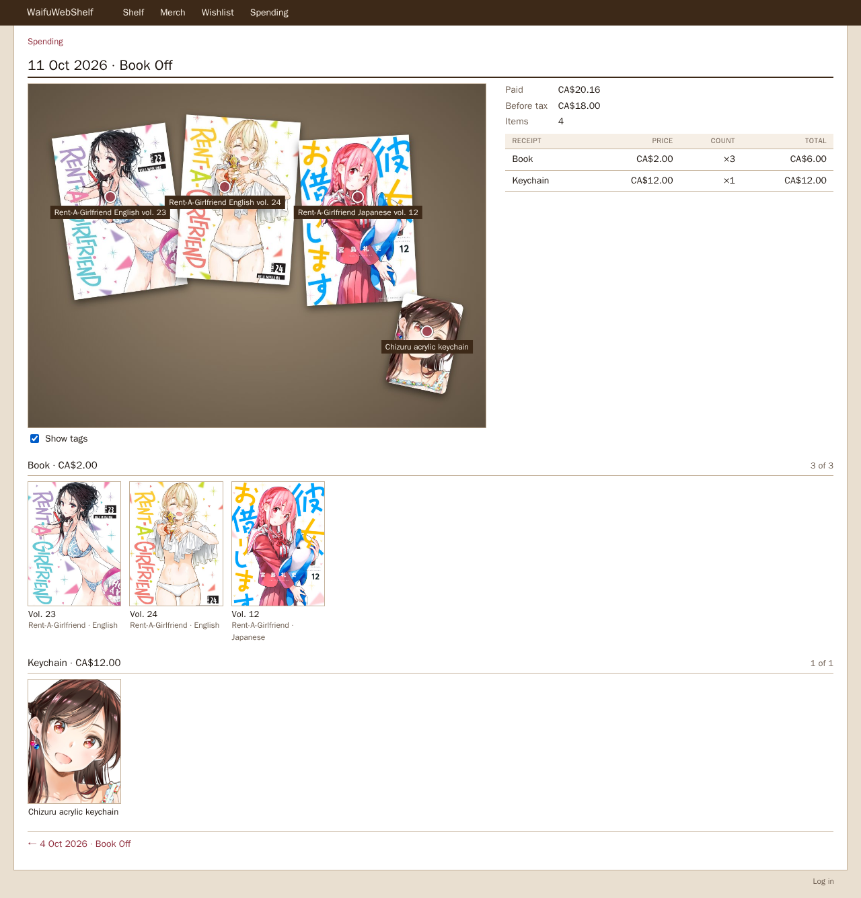
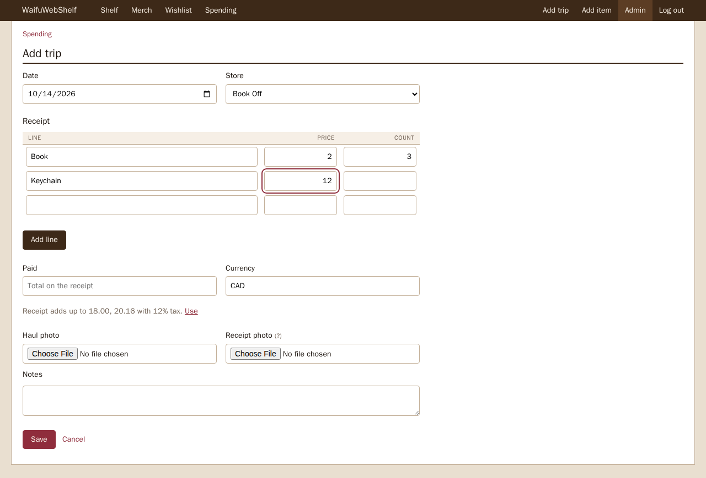

# WaifuWebShelf

A personal catalog of manga, light novels, and merch. One Go binary, SQLite, server-rendered HTML. Public pages are a shelf; adding and editing uses a login form at `/login`.

A **series** is a franchise. Manga vs light novels are **book lines** under that series, each with its own owned/missing volume grid. Merch hangs off the series.

A **trip** is one store visit with its receipt. Enter the receipt lines as printed ("Book $2 × 8"), what you paid, and a photo of the haul if you took one, then add the books and merch onto the lines. Spending totals use what you paid on each trip. Item prices are the receipt prices, before tax. A visit where you bought nothing is a trip with no receipt. On the trip page, tap the haul photo to tag what's where.

Purchases entered before trips existed can be grouped into trips from the admin page, one per day and store. A copy of your data goes in `backups/` in the data folder first.

## Screenshots

| Shelf | Series |
| --- | --- |
|  |  |

| Wishlist | Spending |
| --- | --- |
|  |  |

| Trip | Add trip |
| --- | --- |
|  |  |

More pages, with phone versions, are in `screenshots/v4/`.

## Run locally

```bash
go test ./...
go run ./cmd/waifuwebshelf
```

Then open http://localhost:8080 and log in at http://localhost:8080/login as `admin`. The password is in the log on first start and in `data/admin-password`.

Run from the repository root so `templates/` and `static/` resolve. The SQLite file and uploads live in `data/` (gitignored).

### Environment

| Variable | Default | Notes |
| --- | --- | --- |
| `PORT` | `8080` | Listen port |
| `DATA_DIR` | `data` | SQLite + `images/` |
| `ADMIN_USER` | `admin` | Login username |
| `ADMIN_PASS` | empty | Login password. If unset, one is made on first start, shown in the log, and saved in `admin-password` in the data folder |
| `DISABLE_LOGIN` | `false` | Set to `true` to turn off logging in. The site is then view-only and `ADMIN_PASS` is ignored |
| `SITE_URL` | empty | Public address of the site, like `https://shelf.example.com`. Set it to show a picture when a page link is shared in chat |
| `TRUSTED_PROXIES` | `127.0.0.1,::1` | Comma-separated addresses or ranges of your reverse proxy. Leave as is when the proxy runs on the same machine |

Money is stored as integer minor units (cents for CAD/USD, yen for JPY). Leave MSRP blank when you do not know list price; spending totals skip those rows instead of treating them as $0.

## Deploy on a VPS

Build a binary, copy `templates/` and `static/` next to it, and point `DATA_DIR` at a writable directory.

Restart the service after deploying the binary, templates, or static files. Templates and static assets are loaded at startup; CSS, JavaScript, and icons use content-hashed URLs so browsers fetch changed assets automatically. Public HTML revalidates using a hash of the rendered page, including across restarts.

```bash
go build -o waifuwebshelf ./cmd/waifuwebshelf
```

### systemd

`/etc/systemd/system/waifuwebshelf.service`:

```ini
[Unit]
Description=WaifuWebShelf
After=network.target

[Service]
Type=simple
User=waifuwebshelf
WorkingDirectory=/opt/waifuwebshelf
ExecStart=/opt/waifuwebshelf/waifuwebshelf
Environment=PORT=8080
Environment=DATA_DIR=/var/lib/waifuwebshelf
Environment=ADMIN_USER=admin
Environment=ADMIN_PASS=your-password
Restart=on-failure

[Install]
WantedBy=multi-user.target
```

`WorkingDirectory` must contain `templates/` and `static/`. Create `/var/lib/waifuwebshelf` for the database and photos.

### Caddy

```caddy
shelf.example.com {
    reverse_proxy 127.0.0.1:8080
}
```

### nginx

```nginx
server {
    listen 443 ssl;
    server_name shelf.example.com;

    location / {
        proxy_pass http://127.0.0.1:8080;
        proxy_set_header Host $host;
        proxy_set_header X-Forwarded-For $proxy_add_x_forwarded_for;
        proxy_set_header X-Forwarded-Proto $scheme;
        client_max_body_size 10m;
    }
}
```

Health check: `GET /healthz`.

### Photos

Uploaded photos are shrunk and saved without their camera details, like where they were taken. They're saved as JPEG. Install libwebp on the server (`apt install libwebp7`, `dnf install libwebp`, or `brew install webp`) to save new ones as WebP instead, which are smaller. The log says which one at startup.

### Login attempts

After 5 wrong passwords in a row from one address, further logins from it are refused for 15 minutes. A correct login clears the count.

If your reverse proxy runs on a different machine, add its address to `TRUSTED_PROXIES`. Otherwise every visitor looks like the proxy and shares one lockout.

### Backups

Nothing is backed up for you. Keep a copy of the `DATA_DIR` folder, which holds `shelf.db`, `admin-password` if one was made, and the `images/` and `receipts/` folders.

Stop the service before copying so the copy is complete, then start it again:

```bash
sudo systemctl stop waifuwebshelf
sudo cp -a /var/lib/waifuwebshelf /path/to/backup/
sudo systemctl start waifuwebshelf
```

To restore, stop the service, put the folder back, make sure the `waifuwebshelf` user owns it, and start the service.
